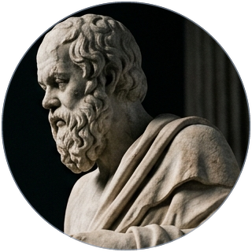

  

    

  

  

    
    
    
  

---

<h3 align="center">Technologies</h3>

  
  
  
  
  
  
  
   
  
  
  
  
  
   
  
  
  
  
  
  

---

<h3 align="center">About Me</h3>

<table>
  <tr>
    <td width="30%" align="center" valign="middle">
      
    </td>
    <td width="70%" valign="middle">
      Hello! My name is <b>Amaan Rizwan</b>, and I am a Full Stack Software Engineer and founder based in Dubai. Currently building web applications and production APIs as an intern at <b>Gattai</b>, and founding <b>Intralead</b>, a real-time B2B lead intelligence platform.
        
      Outside of client and SaaS work, I manage my own self-hosted infrastructure on a 7W low-power Proxmox home server, experiment with interactive 3D web experiences using Three.js and React Three Fiber, and focus on writing clean, reliable, and scalable software.
    </td>
  </tr>
</table>

---

<h3 align="center">Current Focus</h3>

* **Gattai**: Full Stack Software Engineer Intern shipping production web apps, internal tools, and APIs.
* **Intralead**: Real-time B2B lead intelligence platform built with Next.js, Server-Sent Events, and Supabase.
* **Self-Hosted Infrastructure**: Low-power home server running Proxmox, LXC containers, and Cloudflare tunnels.
* **Creative Web**: Building interactive 3D experiences with Three.js and React Three Fiber.

 

  <em>“The unexamined code is not worth shipping.”</em>

